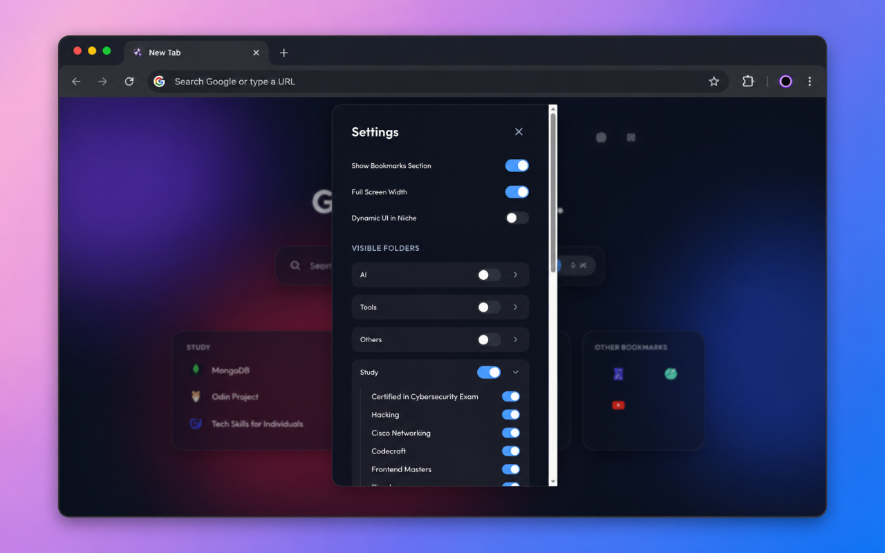

# Home — Minimalist Startpage Chrome Extension

A beautiful, high-performance, and feature-rich new tab override extension for Google Chrome. "Home" blends modern glassmorphic aesthetics with powerful search tools and seamless integration of your native browser bookmarks.


---

## Key Features

### 🎨 Premium Aesthetics & UI
- **Dynamic Mesh Gradient Background:** Three floating, blurred gradient blobs animating smoothly in the background, creating a vibrant, modern depth.
- **Glassmorphic Panels:** UI components styled with high-blur backdrop-filters, subtle inner borders, and soft shadows that work on any background.
- **Full Theme Customization:** Native support for both **Light** and **Dark** themes, automatically syncing with your operating system preferences or toggleable with a single click.
- **Responsive Layout:** Automatically scales across multiple screen widths, supporting both ultra-wide and constrained display alignments.
- **Semantic HTML:** Codebase built with standard semantic HTML tags (`<header>`, `<main>`, `<section>`, `<nav>`, `<aside>`) for superior accessibility and readability.

### 🔍 Advanced Search Engine Capabilities
- **Google & AI Dual Search Modes:** 
  - **Google Mode:** Direct Google search query execution.
  - **AI Mode:** Directs queries using custom Google search parameters designed to display AI Overviews and structured web results.
- **Direct LLM Deep-links:** Accessible dropdown buttons mapping the search term directly into **ChatGPT**, **Gemini**, **Claude**, or **Grok** search query pages.
- **Interactive Search Input:** An elegant, dynamically animated submit arrow seamlessly appears as you type, matching the minimal aesthetic.
- **Google-Powered Autocomplete:** Real-time search predictions retrieved via JSON suggestions from Google's autocomplete endpoint.
- **Smart History Suggestions:** Recalls your last 5 searched queries. Displays history suggestions first with a clock icon for swift re-access.
- **Global Keypress Focus:** Start typing immediately on opening a new tab to autofocus the search input automatically.
- **Full Keyboard Navigation:** Browse suggestions using `ArrowUp` / `ArrowDown` and submit queries with `Enter`.

### 🎙️ Speech & Visual Search Integration
- **Web Speech API Voice Search:** Speak queries naturally via chrome's audio input. Since Chrome extension service workers do not support microphone access directly, a modern **Offscreen Document** bridge is initialized to securely process voice recognition.
- **Multimodal Visual Search:** Drag and drop or upload an image to query visually across **Google Lens**, **Bing**, or **Yandex**. You can optionally add text context to your image searches which is seamlessly parsed and appended to the search engine requests.

### 📱 Google Apps Launcher
- **Quick Access Grid:** A sleek 3x3 popup grid to launch your favorite Google apps and services instantly.
- **Usage-Based Priority:** Apps are intelligently ordered with the most universally used tools (Account, Search, Gmail, Drive, YouTube) prioritized at the top.
- **Clean Typography:** Single-line application names with smooth ellipsis truncation and full-name hover tooltips.

### 🔖 Native Bookmarks Integration
- **Direct Chrome Bookmarks Sync:** Reads bookmarks directly from the Chrome "Bookmarks Bar" tree structure dynamically.
- **Auto-categorization:** Groups bookmarks into glassmorphic tiles representing their respective directories.
- **Untitled Links Grid:** Smartly parses bookmarks without titles and displays them in a compact icon grid, preserving vertical real estate.
- **Loose Link Support:** Any bookmarks sitting at the root level of your bookmarks bar are neatly grouped under a pseudo-folder titled "Other Bookmarks."
- **Horizontal Smooth Scrolling:** Map vertical scroll wheel inputs to pan bookmarks horizontally, allowing rapid sidebar navigation.

### ⚙️ Customizable Settings Modal
- **Layout Toggles:** Toggle bookmarks section visibility, adjust full screen vs. constrained widths, or enable dynamic tile width scaling.
- **Search Memory:** Option to remember the last used search mode configuration.
- **Folder and Link Filter:** Expandable list views of folders and nested links, allowing you to selectively hide or show folders and links on the main page.

---

## Screenshots

| ☀️ Light Mode Theme | 🌙 Dark Mode Theme |
| --- | --- |
|  |  |

| 📑 Bookmarks |  ⚙️ Interactive Settings Modal |
| --- | --- |
|  |  |

---

## Project Structure

```text
minimal-startpage/
├── manifest.json        # Extension Manifest V3 (metadata, overrides, permissions)
├── src/                 # Core source files
│   ├── background.js    # Service Worker (offscreen document launcher & message router)
│   ├── offscreen.js     # Offscreen controller (Web Speech API interface)
│   ├── index.html       # Core HTML layout, SVG assets, and Settings Modal
│   ├── offscreen.html   # Offscreen document bridge
│   ├── css/             # Modular CSS architecture
│   │   ├── base.css              
│   │   ├── main.css              
│   │   ├── theme/theme.css       
│   │   ├── clock/clock.css       
│   │   ├── search/search.css     
│   │   ├── bookmarks/bookmarks.css 
│   │   ├── notes/notes.css       
│   │   └── ui/panels/                   
│   │       ├── top-panel.css      
│   │       └── right-panel.css    
│   └── js/              # ES Module architecture
│       ├── main.js          
│       ├── app.js           
│       ├── state/settings.js
│       ├── theme/theme.js   
│       ├── clock/clock.js   
│       ├── notes/notes.js   
│       ├── bookmarks/index.js
│       ├── search/          
│       │   ├── core/index.js
│       │   ├── voice/voice.js
│       │   └── visual/visual.js
│       └── ui/
│           ├── index.js     # Panel orchestrator
│           └── panels/      # Individual UI panel modules
│               ├── top-panel.js
│               ├── right-panel.js
│               └── bottom-panel.js
├── assets/
│   └── icons/
│       ├── icon.svg         # Vector icon file
│       ├── icon16.png       # 16x16 icon resource
│       ├── icon48.png       # 48x48 icon resource
│       └── icon128.png      # 128x128 icon resource
├── build/               # Compiled extension for distribution
└── screenshots/         # Asset gallery for store visualization
```

---

## Technical Details

### Voice Search via Offscreen Document
Chrome Extensions manifest V3 background scripts execute inside service workers, which lack DOM API accessibility and `navigator.mediaDevices` microphone streams. To implement speech-to-text, "Home" leverages a manifest permission rule for `offscreen` documents:
1. When the microphone button is clicked, `src/js/search/voice/voice.js` fires a message to `background.js`.
2. `background.js` verifies and instantiates `offscreen.html` (with `USER_MEDIA` justifications).
3. The offscreen document runs the browser's native webkitSpeechRecognition engine.
4. Voice transcriptions are passed back dynamically to `voice.js` via `chrome.runtime.sendMessage` broadcasts, populating the input field in real-time.

### Google Lens Upload Protocol
Image search triggers file selection. When chosen, the image is loaded into a visual canvas preview. Upon submit, it compiles into a standard multipart payload posted directly to Lens:
```html
<form id="lens-form" action="https://lens.google.com/upload" method="POST" enctype="multipart/form-data" style="display: none;">
    <input type="file" id="image-search-input" name="encoded_image" accept="image/*">
</form>
```

### Layout Customization Serialization
All client choices (hidden folder keys, layout orientations, theme selections, query histories, hidden bookmark ids) are serialized and persisted locally utilizing `window.localStorage` blocks. This ensures quick startup times when opening new tabs.

---

## Installation & Setup Guide (Local Development)

To run this Chrome extension locally:

1. Clone this repository to your local computer:
   ```bash
   git clone https://github.com/akshitkamboz13/minimal-homepage.git
   cd minimal-homepage
   ```
2. Open Google Chrome and navigate to `chrome://extensions/`.
3. In the top-right corner of the Extensions dashboard, toggle on **Developer mode**.
4. In the top-left, click the **Load unpacked** button.
5. Select the project directory (`minimal-homepage` or the repository folder name) containing the `manifest.json` file.
6. Open a new tab to see your minimalist startpage in action!

---

## GitHub Setup & Deployment

If you are initializing or pushing updates to GitHub, you can use the following commands:

```bash
git init
git add .
git commit -m "Initial commit"
git branch -M main
git remote add origin https://github.com/akshitkamboz13/minimal-homepage.git
git push -u origin main
```

---

## Development & Customization

- **Styling modifications:** Update the design tokens, color combinations, or layout grids in the [src/css/](file:///home/siakshit/Startups/Homepages/minimal-startpage/src/css) directory. The central hub is `main.css`.
- **Core interaction edits:** Modify logic for search routing, suggestions, or bookmark behaviors across the ES Modules in the [src/js/](file:///home/siakshit/Startups/Homepages/minimal-startpage/src/js) directory. The central hub is `main.js`.
- **Extension scope/permissions:** Check or add host origins and extensions configurations in [manifest.json](file:///home/siakshit/Startups/Homepages/minimal-startpage/manifest.json).

---

## Contributing

We welcome community contributions to make "Home" even better! 

### How to Contribute
1. **Fork the Repository:** Create a fork of the `minimal-homepage` repository to your GitHub account.
2. **Create a Branch:** Start a new feature or bugfix branch (`git checkout -b feature/your-feature-name`).
3. **Make Changes:** Add your UI improvements, bug fixes, or entirely new modules. Ensure you stick to the ES6 module architecture and separate your CSS!
4. **Test Locally:** Load your unpacked extension in Chrome and verify functionality.
5. **Submit a Pull Request:** Push your changes to your fork and submit a PR to the main repository.

### Code Style Guidelines
- **HTML:** Use semantic tags (`<header>`, `<main>`, `<section>`) over generic `<div>` tags whenever possible.
- **CSS:** Keep styles modular. Variables go in `theme.css`, new components get their own files in the `src/css/` directory and are imported in `main.css`. Avoid `!important`.
- **JavaScript:** Use lowercase kebab-case for filenames (e.g. `right-panel.js`). Always use ES Modules (`export default`). Do not pollute the global window object.
