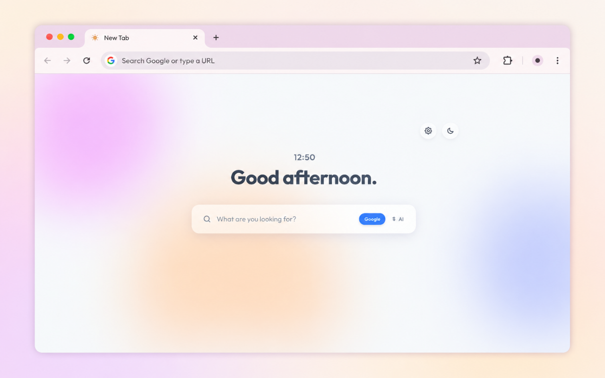
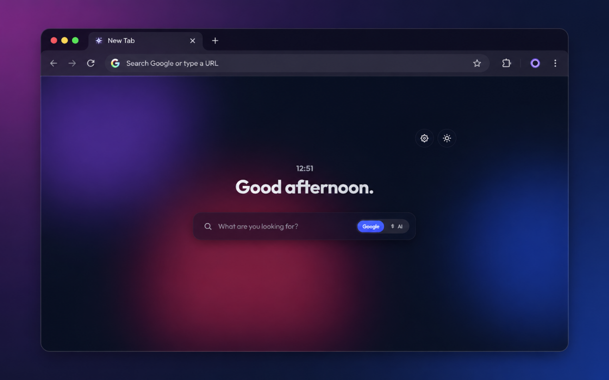
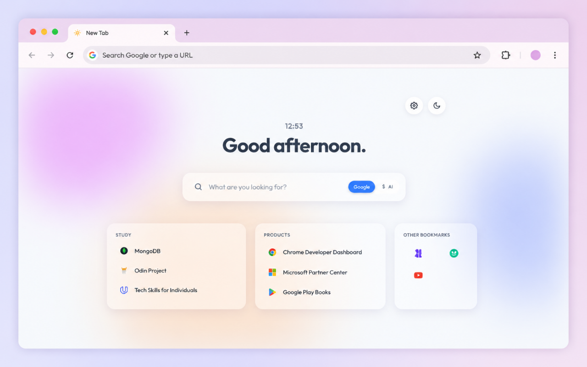
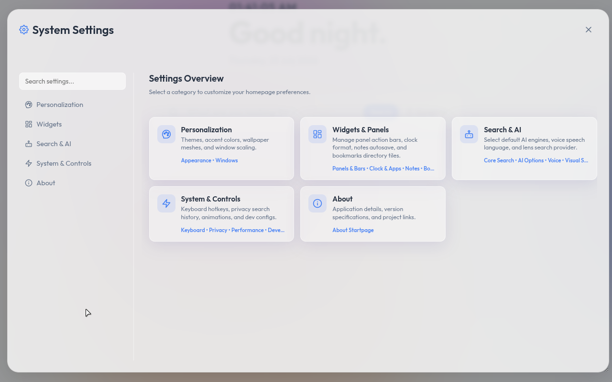

# Home — Minimalist Startpage Chrome Extension

A beautiful, high-performance, and feature-rich new tab override extension for Google Chrome. "Home" blends modern glassmorphic aesthetics with powerful search tools and seamless integration of your native browser bookmarks.



---

## Key Features

### 🎨 Premium Aesthetics & UI
- **Dynamic Mesh Gradient Background:** Three floating, blurred gradient blobs animating smoothly in the background, creating a vibrant, modern depth.
- **Glassmorphic Panels:** UI components styled with high-blur backdrop-filters, subtle inner borders, and soft shadows that work on any background.
- **Full Theme Customization:** Native support for both **Light** and **Dark** themes, automatically syncing with your operating system preferences or toggleable with a single click.
- **Responsive Layout:** Automatically scales across multiple screen widths, supporting both ultra-wide and constrained display alignments.
- **Semantic HTML:** Codebase built with standard semantic HTML tags (`<header>`, `<main>`, `<section>`, `<nav>`, `<aside>`) for superior accessibility and readability.

### 🎛️ Panels & Bars Configuration
- **Vertical Panel (Right Panel / FABs):**
  - **Screen Edge Placement:** Position floating action buttons cleanly on either the **Right Edge** or **Left Edge**.
  - **Action Icon Sizing:** Adjust floating icon sizes dynamically (`Small 16px`, `Medium 20px`, `Large 24px`, `Extra Large 28px`).
  - **Individual Icon Toggles:** Selectively show or hide individual floating action buttons (**Google Apps Grid `:::`**, **Visual Search Camera 📷**).
- **Horizontal Panel (Top Action Header):**
  - **Fixed Screen Edge Placement:** Fixed positioning at either the **Top Screen Edge** or **Bottom Screen Edge**.
  - **Header Icon Sizing:** Adjust top header icon sizes dynamically (`Small 16px`, `Medium 20px`, `Large 24px`, `Extra Large 28px`).
  - **Individual Icon Toggles:** Selectively show or hide individual top action triggers (**Add Sticky Note ➕**, **Settings Gear ⚙️**, **Theme Switcher ☀️/🌙**).
- **Application Dock:** Floating application dock controls preview (tagged with Coming Soon / Under Development).

### 🔍 Search & AI Options
- **Core Search Settings:** Configure **Remember Search Mode**, **Search History Limit**, **Live Suggestions Limit**, and **Fetch Google Suggestions**.
- **AI Options:** Select primary assistant shortcut (**Google AI**, **ChatGPT**, **Claude**, **Bing AI**, **Grok**) or register custom LLM search query endpoints.
- **Voice Search:** Web Speech API audio language configuration and auto-submit voice search toggles.
- **Visual Search:** Multimodal image search supporting **Google Lens**, **Bing**, and **Yandex** visual search engines with optional context suffix support.

### 📱 Google Apps Launcher
- **Quick Access Grid:** A sleek 3x3 popup grid to launch your favorite Google apps and services instantly.
- **Usage-Based Priority:** Apps are intelligently ordered with the most universally used tools (Account, Search, Gmail, Drive, YouTube) prioritized at the top.
- **Clean Typography:** Single-line application names with smooth ellipsis truncation and full-name hover tooltips.

### 🔖 Native Bookmarks Integration
- **Direct Chrome Bookmarks Sync:** Reads bookmarks directly from the Chrome "Bookmarks Bar" tree structure dynamically.
- **Auto-categorization:** Groups bookmarks into glassmorphic tiles representing their respective directories.
- **1D Row vs 2D Grid Layouts:** Switch seamlessly between 1D row array and auto-tiling 2D grid array layouts.
- **Dual-Axis & Mouse Wheel Scrollability:** Natural vertical mouse wheel scrolling (`scrollTop`) and horizontal scrolling over bookmark folders.
- **Document-Body Handles Overlay:** Unclipped floating resize handles overlay allowing easy widget resizing up to full screen width.

---

## Screenshots

| ☀️ Light Mode Theme | 🌙 Dark Mode Theme |
| --- | --- |
|  |  |

| 📑 Bookmarks | ⚙️ Interactive Settings Modal |
| --- | --- |
|  |  |

---

## Project Structure

```text
minimal-startpage/
├── manifest.json        # Extension Manifest V3 (metadata, overrides, permissions)
├── src/                 # Core source files
│   ├── background.js    # Service Worker (offscreen document launcher & message router)
│   ├── offscreen.js     # Offscreen controller (Web Speech API interface)
│   ├── index.html       # Core HTML layout, SVG assets, and Settings Modal
│   ├── offscreen.html   # Offscreen document bridge
│   ├── css/             # Modular CSS architecture
│   │   ├── base.css              
│   │   ├── main.css              
│   │   ├── theme/theme.css       
│   │   ├── clock/clock.css       
│   │   ├── search/search.css     
│   │   ├── bookmarks/bookmarks.css 
│   │   ├── notes/notes.css       
│   │   └── ui/panels/                   
│   │       ├── top-panel.css      
│   │       └── right-panel.css    
│   └── js/              # ES Module architecture
│       ├── main.js          
│       ├── app.js           
│       ├── state/settings.js
│       ├── theme/theme.js   
│       ├── clock/clock.js   
│       ├── notes/notes.js   
│       ├── bookmarks/index.js
│       ├── search/          
│       │   ├── core/index.js
│       │   ├── voice/voice.js
│       │   └── visual/visual.js
│       └── ui/
│           ├── index.js     # Panel orchestrator
│           └── panels/      # Individual UI panel modules
│               ├── top-panel.js
│               ├── right-panel.js
│               └── bottom-panel.js
├── assets/
│   └── icons/
│       ├── icon.svg         # Vector icon file
│       ├── icon16.png       # 16x16 icon resource
│       ├── icon48.png       # 48x48 icon resource
│       └── icon128.png      # 128x128 icon resource
├── build/               # Compiled extension release zip builds (v1.2.0)
└── screenshots/         # Asset gallery for store visualization
```

---

## Installation & Setup Guide (Local Development)

To run this Chrome extension locally:

1. Clone this repository to your local computer:
   ```bash
   git clone https://github.com/akshitKamboj13/minimal-homepage.git
   cd minimal-homepage
   ```
2. Open Google Chrome and navigate to `chrome://extensions/`.
3. In the top-right corner of the Extensions dashboard, toggle on **Developer mode**.
4. In the top-left, click the **Load unpacked** button.
5. Select the project directory (`minimal-homepage` or the repository folder name) containing the `manifest.json` file.
6. Open a new tab to see your minimalist startpage in action!

---

## GitHub Setup & Deployment

If you are initializing or pushing updates to GitHub, you can use the following commands:

```bash
git init
git add .
git commit -m "Initial commit"
git branch -M main
git remote add origin https://github.com/akshitKamboj13/minimal-homepage.git
git push -u origin main
```

---

## License & Author

Open-source minimalist startpage created with passion by **Akshit Kamboz (si4k)**. Free to use, adapt, and build upon.
